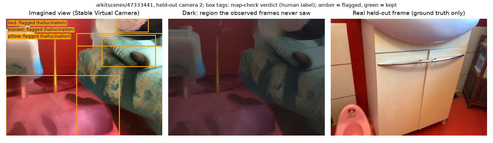
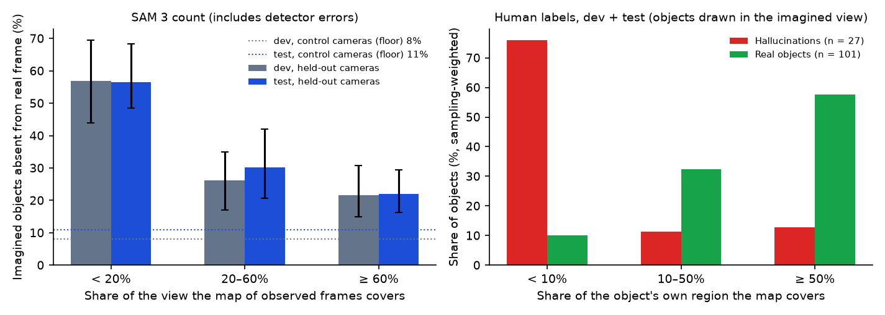
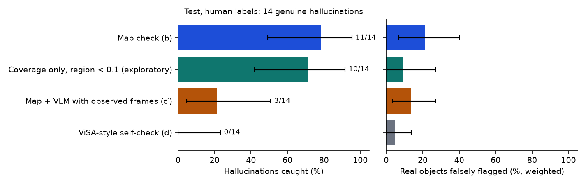

# REImagine: do world-model imaginations help a VLM, and can we tell when they lie?

**Summary.** We gave a vision-language model (Qwen3-VL-8B) a camera-controlled video world
model (Stable Virtual Camera) to "imagine" new viewpoints of a room, as MindJourney does.
We find that (i) Imagination did not improve spatial question answering, and hurts perspective questions answering. (ii) The world model's hallucinations sit mainly in regions the real frames never observed (as expected). We tried an intervention and found (iii) VLM checks miss these hallucinations: a VLM looking at the imagined frame caught 0 of 14, and a VLM given the real frames caught 3 of 14, against 11 of 14 for a check against a 3D map of the real frames. (iv) A coverage test, "did the real frames ever see this region?", caught 10 of 14 with fewer false flags. 



## Results

<!-- summary:start -->
<!-- Generated by scripts/make_summary.py. Do not edit by hand. -->

| Status | Result | Value |
|---|---|---|
| dev only | `imagine` − `vlm_only`, VSI-Bench, MindJourney's evidence rule (helpfulness ≥ 8) | -0.6 points (95% CI -6.0 to +3.8), n = 100 |
| dev only | `imagine` − `vlm_only`, VSI-Bench, two imagined views always | -4.5 points (95% CI -11.3 to +2.4), n = 100 |
| dev only | `imagine` − `vlm_only`, SAT perspective, strict circular, two imagined views always | -8.2 points (95% CI -14.4 to -2.1), n = 97 |
| confirmed on test (pre-registered) | Imagined objects SAM 3 finds absent from the real frame (test): views the map covers < 20% vs ≥ 60% | 57% (48 to 68) vs 22% (16 to 29); control floor 11% (count includes detector errors) |
| confirmed on test (pre-registered) | Claims SAM 3 marks invented that are detector errors / genuine hallucinations (test, human labels) | 80 / 14 of 109 |
| dev only | Claims SAM 3 marks invented that are detector errors / genuine hallucinations (dev, human labels) | 48 / 13 of 65 |
| confirmed on test (pre-registered) | Hallucinations caught: VLM looking at the imagined frame only (ViSA-style, (d)) vs map check (b) | 0/14 (0–23%) vs 11/14 (49–95%); exact McNemar p = 0.001 |
| confirmed on test (pre-registered) | Hallucinations caught: VLM with the observed frames where the map is blind ((c′), main baseline) vs map check (b) | 3/14 (5–51%) vs 11/14 (49–95%); exact McNemar p = 0.008 |
| confirmed on test (pre-registered) | Real objects falsely flagged (weighted): (b) / (c′) / (d) | 21% (7–40) / 14% (3–27) / 5% (0–14) |
| exploratory | Coverage test alone (flag objects whose region the map covers < 10%; threshold from dev): hallucinations caught, false flags | 10/14 (42–92%), 9% (0–27); vs (b) paired p = 1.00 |
| confirmed on test (pre-registered): **not met** | F1 of (b) − (d) against automatic ground truth (SAM 3 and Qwen agree; dominated by detector errors) | +13% (-1 to +25) points; criterion needed the interval to exclude 0 |
| dev only | Combined rule ((b) and VLM doubt) to cut false flags: some threshold with recall ≥ 70% and false flags ≤ 10% | none found; not taken to test |
| not run | Downstream: answer accuracy with imagined views filtered by (b) | optional run not done |
<!-- summary:end -->

Intervals are 95%: scene-level bootstrap for rates and differences, exact (Clopper–Pearson)
for counts out of 14. Weighted rates undo the enriched sampling of the human-labelled test
sheet. Every number comes from `scripts/make_summary.py` reading the raw records in
`results/` and the labels in `data/labels/`.





**Reading the table.**
- Most objects that the detector reports as "invented" are detector errors: SAM 3 finding an
  object in a blurry generated view where none is drawn. Only human labels separate these
  from genuine world-model hallucinations (object drawn, but absent from the real frame).
- A VLM that judges the imagined frame cannot see that a drawn object is absent from the
  room; it accepts it. Its flags land mostly on detector errors.
- Checks grounded in the observed frames catch most genuine hallucinations because these
  sit where the observed frames never looked. The object labels in the map add little on
  these 14 cases: the coverage test alone did about as well.
- All methods have low precision in the population, because genuine hallucinations are rare
  among the objects a detector reports.

## What was tried and did not work

- **Imagination as evidence** (MindJourney-style search, one step, 9° turns, 0.25 m-equivalent
  forward steps): three rules for which imagined views reach the answer (helpfulness ≥ 8,
  ≥ 5, always the top two). None improved on `vlm_only`; more imagined views, lower scores.
  Larger turns and deeper search were not run (compute).
- **Matching object labels against the map** beyond coverage: no measurable gain over the
  coverage test on the 14 test hallucinations, with more false flags (exploratory).
- **Cutting false flags** by also requiring the VLM to doubt the object: no threshold on dev
  kept recall ≥ 70% with false flags ≤ 10%, so it was not taken to test.
- **Automatic ground truth** (SAM 3 and Qwen agreeing on the real frame): the pre-registered
  F1 comparison against the self-check was not met on test. Detector errors dominate that
  ground truth, which is why the human-labelled test was added and pre-registered.
- **A claim-level verifier** (spatial relations, distances, a trust policy) was implemented
  and unit-tested but never evaluated; it was removed before release.

## Method

- **Setting (sparse-view VSI-Bench).** For each video, 8 frames are *observed* (segment
  midpoints) and 8 are *held out* (segment starts). Methods see only observed frames; held-out
  frames are ground truth for what unseen parts of the room look like. Scenes are split into
  dev (72) and test (216) once, by a seeded rule saved in `data/splits/`.
- **Poses and map.** VGGT-1B runs on the 16 frames together to put every camera in one frame;
  the map uses depth from the 8 observed frames only (top 70% confidence). SAM 3 masks for a
  fixed list of 40 indoor object types are lifted into 3D with that depth.
- **World model.** Stable Virtual Camera v1.1 receives the 8 observed frames with their VGGT
  poses and renders each held-out camera, plus 3 observed cameras as controls (384×512,
  21 frames per pass, 20 steps, cfg 2.0, fp16, seed 0, on a Kaggle T4).
- **Claims.** Each object type SAM 3 finds in an imagined view (score ≥ 0.5, area ≥ 0.2%) is the
  claim "this object is visible from this camera".
- **Coverage.** The observed-frame point cloud is rendered at the held-out camera; a pixel is
  covered when a map point lands on it. *Region coverage* is the covered share of the claim's
  mask. The coverage test flags a claim with region coverage below 10%.
- **Map check (b).** Keep a claim only if map points labelled with that object project,
  unoccluded, onto at least 0.2% of the view's pixels; otherwise flag it.
- **Baselines.** (d) ViSA-style self-check: Qwen3-VL answers whether the object is visible in
  the imagined frame alone. (c′) Map where the claim's region is covered; elsewhere Qwen3-VL
  judges the imagined frame together with the observed frames.
- **Ground truth.** Human labels on a pre-registered sample (both questions per claim:
  visible in the real frame? visible in the imagined view?). Automatic truths (SAM 3, Qwen
  on the real frame) were also reported.
- **Protocol.** Thresholds fixed before the pilot or chosen on dev only; four analyses were
  pre-registered, each committed before its data were opened (texts in
  `docs/PREREGISTRATION.md`); test scenes were used once per analysis; paired comparisons (exact McNemar, paired bootstrap) and scene-level
  bootstrap intervals throughout; every run records its commit (of the private development repository), config and environment.

## Limitations

- **14 genuine hallucinations** on test (13 on dev). Intervals are wide; the map check and the
  coverage test cannot be told apart.
- **One world model** (Stable Virtual Camera), **one VLM** (Qwen3-VL-8B), one imagination
  search setting (one step, small turns).
- **Object presence only.** No spatial relations, distances or counts were checked.
- **One primary labeller.** Consistency on 30 hidden repeats: 100% (real frame) and 92% (imagined
  view, kappa 0.83). A second labeller on 50 test claims agreed on every claim both answered
  fully (47); whether they labelled independently is **not yet confirmed**. An independent
  labelling of the 14 hallucinations plus 40 other claims is **pending**.
- **Low precision for every method** in the population (see
  `results/hallucination_human_extra.md`).
- The earlier pre-registered test against automatic ground truth was **not met**.
- The downstream check (answer accuracy with filtered imagined views) was **not run**.
- Full-video baselines used 336×336 frames and sparse runs 448×448. SVC's VAE came from a
  community mirror of SD 2.1 base (the official repository returned 401).
- The novelty search was done from abstracts; it must be repeated with full-text reading
  before any write-up.

## Reproduce

Analysis from the committed records (no GPU, a few minutes on a laptop CPU):

```bash
uv venv --python 3.12 && uv pip install -r requirements/analysis.txt
cd scripts
python make_summary.py                 # README results table and results/summary.md
python make_figures.py                 # figures; the example panel also needs the dev views and SAM 3 weights
python human_label_test_report.py --labels ../data/labels/human_labels_test.csv \
    --second ../data/labels/human_labels_second.csv --out ../results/hallucination_human_test.md
python human_label_extra.py --out ../results/hallucination_human_extra.md
python hallucination_headtohead.py --records ../results/hallucination_v2 --out ../results/hallucination_headtohead.md
python hallucination_headtohead.py --records ../results/hallucination_test --prereg "section 3" \
    --split-name "20 test scenes" --out ../results/hallucination_headtohead_test.md
cd .. && python -m pytest -q           # 100 tests
```

Demo on cached examples (no GPU, no downloads; ARKitScenes views only):

```bash
pip install -r demo/requirements.txt && python demo/app.py
```

GPU runs (Kaggle, 2× Tesla T4, environment in `requirements/kaggle.txt`). Each job installs its
dependencies, downloads VSI-Bench (about 6 GB of videos) and the model weights, and records
the commit. Stable Virtual Camera and SAM 3 are gated on Hugging Face and were attached as
private Kaggle datasets (`raghavthind05/svc-weights`, `raghavthind05/sam3-weights`).

```bash
python scripts/kaggle_launch.py --job kaggle/jobs/<job>.json
```

| Result | Job | Measured time |
|---|---|---|
| `vlm_only` baselines (frame sweep, full video) | `p2_frame_sweep_448`, `p2_full32_sub200` | 1.0 h, 0.8 h |
| `imagine` mode, VSI-Bench 100 q / SAT 97 q | `p2_imagine_vsi100`, `p2_imagine_sat97` | 2.0 h, 1.6 h |
| Hallucination study, dev (20 scenes) | `p2_hallucination_v2`, then `p3_vlm_scores` | 1.7 h, 0.5 h |
| Hallucination study, test (20 scenes) | `p3_hallucination_test` | 2.1 h |
| Downstream check (not run) | `p3_downstream` | about 2 h (smoke-measured) |

Then copy each job's `runs/` output into `results/` (same layout as `results/hallucination_test/`). Human
labelling sheets: `scripts/make_label_sheet.py` (dev), `scripts/make_test_label_sheet.py` (test),
`scripts/make_independent_sheet.py` (independent labeller); samples are fixed in
`data/labels/*.json`.

Total GPU use for the whole project: 24.5 Kaggle T4 session-hours.

## Repository

- `docs/ARCHITECTURE.md` — how the code fits together.
- `docs/PREREGISTRATION.md` — the four pre-registered analyses, verbatim.
- `docs/LICENSES.md` — licence of every model and dataset, and what it allows.
- `docs/LITERATURE.md` — notes on the papers this work builds on.
- `results/` — raw records, generated reports and figures; `data/` — splits and labels.

## Credits and licences

Qwen3-VL-8B-Instruct (Alibaba, Apache-2.0); VGGT-1B (Meta, CC-BY-NC-4.0); SAM 3 (Meta, SAM
License — this work used SAM materials); Stable Virtual Camera (Stability AI, Non-Commercial
License); SD 2.1 base VAE (OpenRAIL++-M). VSI-Bench (Apache-2.0) with videos from ScanNet,
ScanNet++ and ARKitScenes (© Apple Inc., non-commercial licence; the only imagery shown here);
SAT (MIT). MindJourney's search was reimplemented from the paper (its code has no licence).
The code is MIT-licensed (`LICENSE`); the models, data and ARKitScenes imagery keep their own,
mostly non-commercial, terms (`docs/LICENSES.md`).
